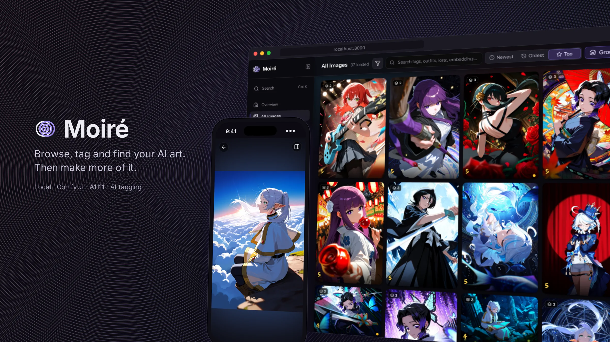
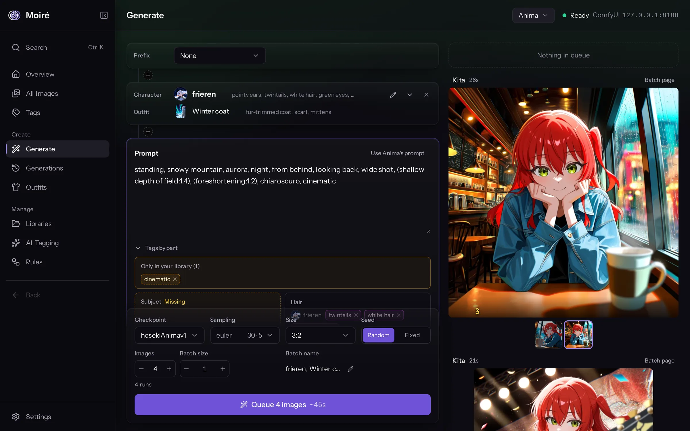
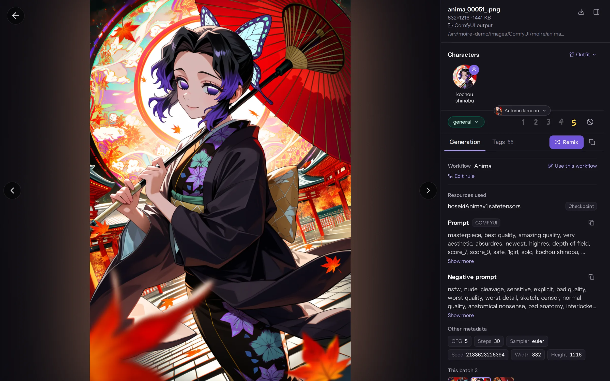
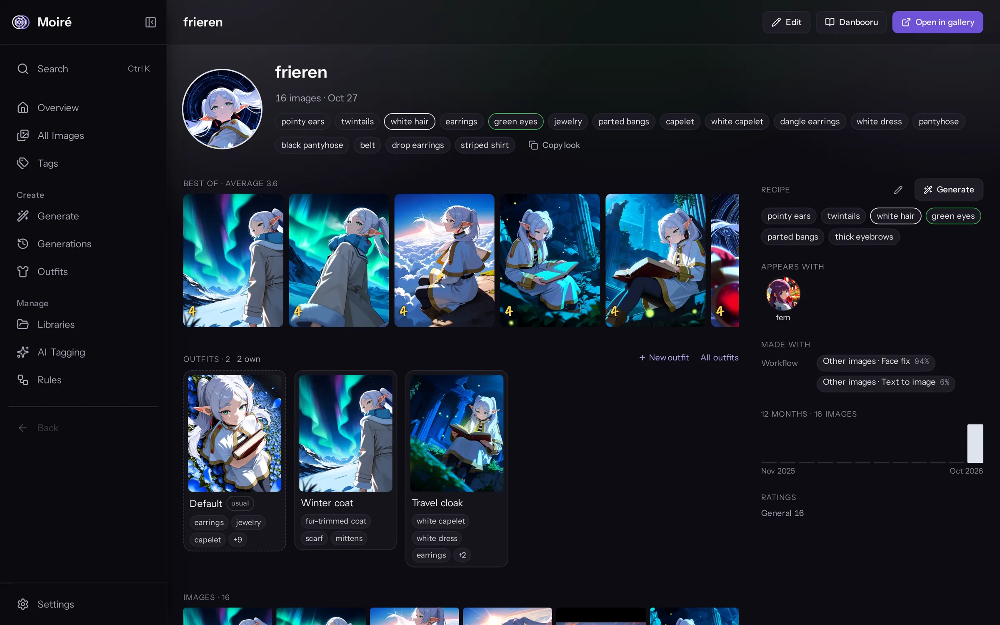
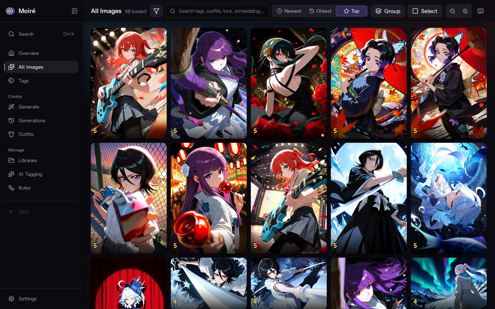
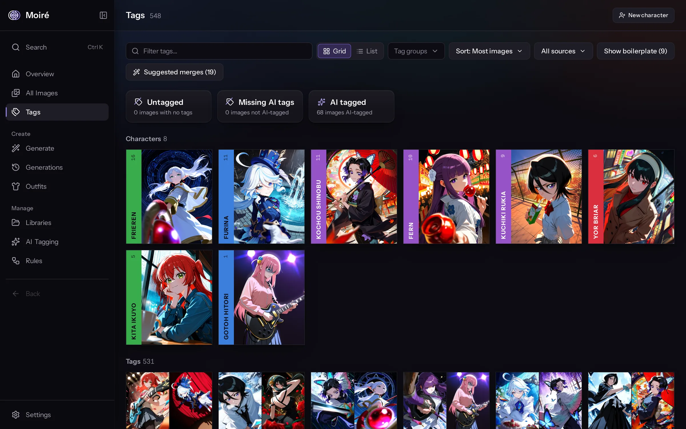
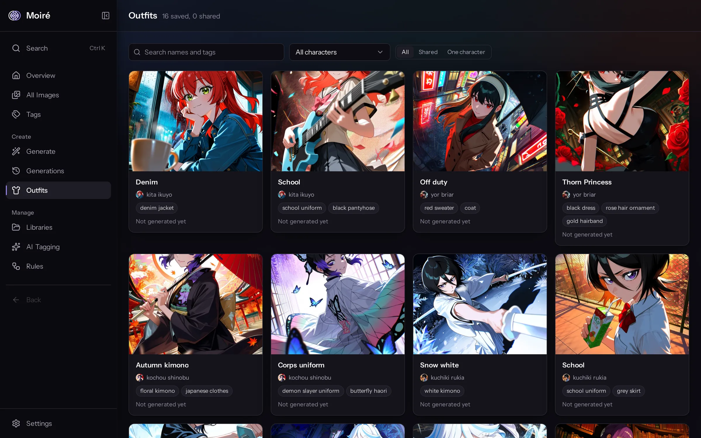
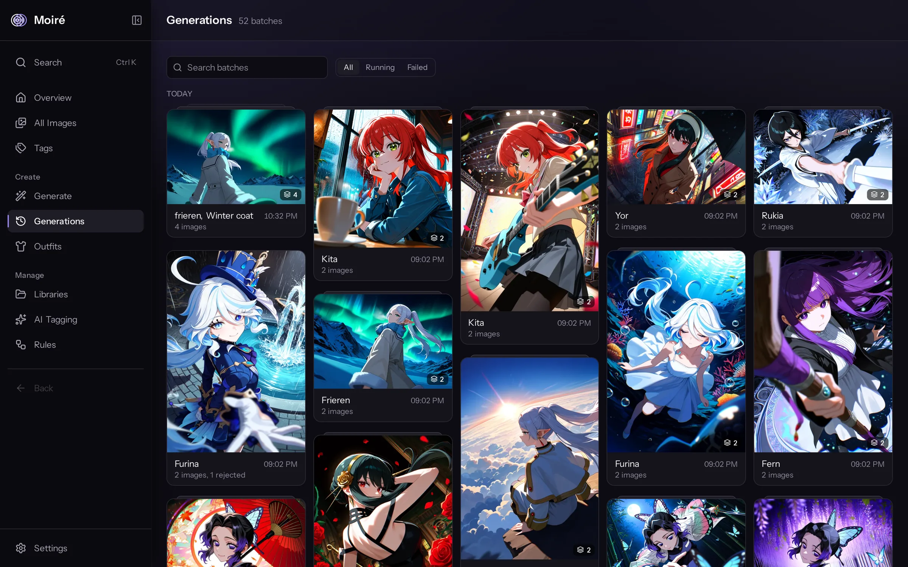
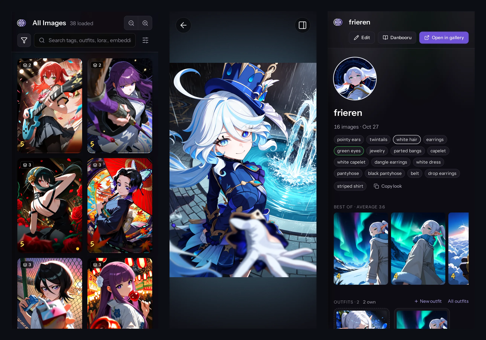

# Moiré



**A local gallery for your AI art, with tagging, search and ComfyUI generation built in.**

Point Moiré at the folders your ComfyUI or Automatic1111 output lands in. It reads every image's prompt and settings, tags it with a local AI tagger, works out which characters and outfits are in it, and gives you a fast gallery to sort through thousands of generations. Hook it up to ComfyUI and you can generate straight from your library.

Everything runs on your machine as a single process with an embedded database, and nothing gets uploaded.




Pick a character from your library, dress them in a saved outfit, write the scene, and queue it on your ComfyUI. **Tags by part** sorts the prompt into subject, hair, eyes, attire, pose, framing, background and lighting, so a missing part or a stray tag shows at a glance. Hover a tag to see what it means and the images in your library that have it; type into a part to get suggestions for that part only. The results land back in the gallery, prompt and all.

## What it does

- It reads the prompt, negative prompt, seed, sampler, checkpoint and LoRAs out of ComfyUI and A1111 PNGs. Prompt weights like `(foreshortening:1.2)` are kept, and every prompt term becomes a tag you can search.
- A built-in WD tagger (ONNX, on the CPU or an NVIDIA GPU) adds AI tags and a content rating. It needs no cloud service or API key.
- It spots characters from the tagger's list and gives each one a page with their face, look, best images and the outfits they wear, plus a recipe for generating them again.
- You can filter by tags (AND or OR), characters, outfits, LoRAs, embeddings, rating, stars or library, and `Ctrl+K` searches across all of it.
- You can rate images 1 to 5 stars, quarantine them without deleting, tag by hand and select in bulk.
- With a ComfyUI connected, you pick characters and outfits, write the scene and queue. Use the built-in workflow, or set up your own from an exported workflow file or any image it made. Any image in the viewer can be remixed.
- A virtualized masonry grid and keyset paging keep scrolling smooth with tens of thousands of images. Libraries are watched, so new images show up by themselves.
- Run it on your LAN and it works on your phone too.

## Screenshots

| | |
|---|---|
|  |  |
| The viewer, with characters, outfit, rating, generation data and Remix | A character page: look, best images, outfits and recipe |
|  |  |
| The gallery sorted by stars, each batch stacked into one tile | Tags, with characters first and a cover for every tag |
|  |  |
| Outfits saved per character, ready to reuse in Generate | Generations, every batch you queued |



The images in these screenshots were made with Moiré's own Generate page.

## Install

You need [uv](https://docs.astral.sh/uv/getting-started/installation/). It brings its own Python.

```bash
uv tool install "moire-studio[cpu]"   # or "moire-studio[gpu]" for tagging on an NVIDIA GPU
moire run --open                       # opens http://localhost:8000
```

> [!NOTE]
> Moiré isn't on PyPI yet. Until the first release, run it from a source checkout: see [CONTRIBUTING.md](CONTRIBUTING.md#setup), or use Docker below.

That's the whole app: the API and the UI on one port. To reach it from other devices on your network, use `moire run --host 0.0.0.0`.

The GPU build (Linux and Windows) pulls the CUDA and cuDNN runtime from pip, about 2 GB, and needs only the NVIDIA driver. Tagging is roughly 9x faster than on the CPU.

### Docker

```bash
git clone https://github.com/mNandhu/moire.git
cd moire
docker compose up --build              # UI on http://localhost:5173
```

Moiré can only see folders mounted into the container. Add yours in `docker-compose.override.yml`, then add the library in the UI by its path inside the container:

```yaml
services:
  backend:
    volumes:
      - /absolute/path/to/your/images:/mnt/images:ro
```

[docs/docker-guide.md](docs/docker-guide.md) covers the data volume, logs and settings.

## First run

The welcome screen has three steps, and each one can be skipped:

1. Folders: add the folders your images are in. Tick "each subfolder becomes its own library" to split a big output folder. Moiré previews what it will add, then scans in the background.
2. AI tagging: download the tagger model (about 380 MB, from Hugging Face, once) and tag what you have. Later, the AI Tagging page tags whatever is still untagged in one click.
3. ComfyUI: enter your ComfyUI address (`127.0.0.1:8188`). Generate shows up in the sidebar once it connects.

All of it can be changed later in Settings.

## Generating with ComfyUI

Moiré talks to ComfyUI over its normal API, so it works with a ComfyUI on the same machine, on another box, or behind a reverse proxy. Besides the address, you can give it a certificate path for a self-signed HTTPS setup and extra headers, such as an `Authorization` token, if your ComfyUI needs them.

Tell Moiré where ComfyUI saves its output. If Moiré can read that folder, it links new images where they already are. If it can't, as with a remote ComfyUI, turn on "Download images from ComfyUI" and they get downloaded into a library.

The built-in workflow is ComfyUI's default text-to-image graph with your checkpoint. To use your own, pick an image it made or upload an *Export (API)* file. Moiré finds the prompt, seed, size and sampler inputs, and the workflow is ready once a test image comes through.

A character you pick in Generate brings their recipe (the tags that make them look right) and whichever outfit you choose. Prefixes, negative prompts and style LoRAs can be saved as presets.

## Where your data lives

```bash
moire paths
```

prints the database, thumbnails, tagger models and logs. An installed Moiré keeps them in your app-data folder:

| OS | Folder |
|---|---|
| Windows | `%LOCALAPPDATA%\Moire` |
| macOS | `~/Library/Application Support/Moire` |
| Linux | `~/.local/share/moire` |

Set `MOIRE_HOME` to put them somewhere else. A `.env` file in that folder holds optional settings (see [`.env.example`](packages/backend/.env.example)).

Moiré never moves or edits your images. It reads them and keeps its thumbnails next to its own database, and deleting an image from disk asks you to confirm first. The file worth backing up is the database (`moire.db`), since a rescan rebuilds the thumbnails.

## Upgrading

```bash
uv tool upgrade moire-studio
```

The database updates itself on the next start, so there is no migration to run. With Docker, run `git pull` and `docker compose up --build`, and the data volume carries over.

## Custom workflows and the Rules page

Moiré parses standard ComfyUI graphs by itself, but a workflow with unusual nodes can come through with the prompt or model empty. On the Rules page, pick that workflow, point each field at the node it comes from, check the preview and save. Moiré then re-reads every image from that workflow in every library.

## Contributing

Setup, tests and the project layout are in [CONTRIBUTING.md](CONTRIBUTING.md). See [CHANGELOG.md](CHANGELOG.md) for what changed and [ROADMAP.md](ROADMAP.md) for what's next.

## License

MIT. See [LICENSE](LICENSE).
